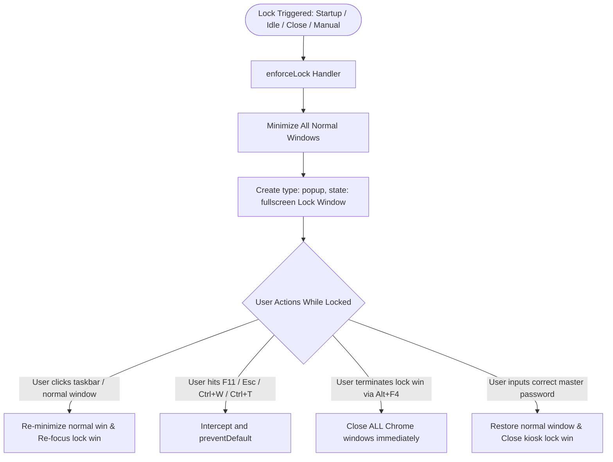

# 🛡️ Browser-Locker

> **Native OS-grade browser lock for Chromium browsers (Manifest V3).**  
> Built with native Web Crypto API (SHA-256 with cryptographically random salts), zero-knowledge offline recovery, bulletproof window-close detection, a clean flat Zinc/Slate design system, and an external toolbar-free fullscreen kiosk window architecture.

---

## ⚡ Key Capabilities

* 🔐 **Zero Plain-Text Credentials:** Master passwords and recovery keys are never stored in plain text. All secrets are salted with a 128-bit random salt and digested with `SHA-256` via the standard `crypto.subtle` Web Crypto API.
* 🖥️ **Toolbar-Free Fullscreen Kiosk Architecture:** Normal browser windows are minimized upon locking so the address bar, bookmarks bar, and extension toolbar ("Remove from Chrome" right-click menu) are completely inaccessible. The lock screen runs in a dedicated `type: "popup"`, `state: "fullscreen"` window with zero browser chrome.
* 🪤 **Inescapable Focus Trap & Anti-Bypass Guard:** If the user attempts to restore or click a minimized normal window, it is immediately re-minimized and focus returns to the fullscreen lock window. If the user closes the lock window (e.g. via Alt+F4 or window X) while locked, all remaining Chrome windows are immediately terminated, causing the browser to safely exit.
* 🛑 **Window-Close Auto-Lock (Windows Background Fix):** Solves the Windows Chromium issue where closing all browser windows leaves background processes alive without triggering `onStartup`. Browser-Locker listens to `chrome.windows.onRemoved` and locks immediately once the total window count drops to zero.
* ⏱️ **Default 0-Minute Grace Period:** Configured by default to `0` minutes so that closing and reopening the browser ALWAYS demands the master password immediately.
* ⌨️ **Keyboard Interception:** Blocks `F11`, `Escape`, `Ctrl+W`, `Ctrl+T`, `Ctrl+N`, `Ctrl+Shift+N`, `Alt+F4`, and devtools shortcuts while locked. Automatically re-enforces fullscreen if the display changes.
* 🔒 **Secure Popup Authentication:** Opening the extension popup while locked displays **only** a compact password entry prompt. Settings, toggles, or controls are never exposed without prior authentication.
* ⚡ **Immediate Autofocus:** Password inputs in `lock.html` and `popup.html` have autofocus enabled so users can type their password immediately upon launch without clicking.
* 🎨 **Native OS Design System:** Clean, flat Zinc 900/800 design (`#18181b` backdrop, `#27272a` cards, `#3f3f46` borders, `#2563eb` buttons, and `-apple-system` native system typography). Zero neon glows, purple gradients, or artificial animations.

---

## 🏗️ Architecture



---

## 📂 Project Structure

```
Browser-Locker/
├── manifest.json              # Chrome Manifest V3 configuration & permissions
├── crypto.js                  # Native Web Crypto API SHA-256 salted hashing & key gen
├── background.js              # Service Worker: Kiosk popup management & focus trap
├── lock.html                  # Toolbar-free fullscreen native 360px lock dialog
├── lock.js                    # Lock controller with keyboard trap, autofocus & lockout
├── popup.html                 # 340px native popup (locked auth view & unlocked settings)
├── popup.js                   # Popup view switcher & credential manager
├── styles.css                 # Neutral Zinc/Slate native OS design system
├── icons/                     # Extension graphics
│   ├── icon.svg               # Vector icon source
│   ├── icon16.png             # 16x16 toolbar icon
│   ├── icon48.png             # 48x48 extension management icon
│   ├── icon128.png            # 128x128 store/retina icon
│   └── generate_icons.html    # Standalone HTML5 Canvas icon generator
├── scripts/
│   └── build_icons.py         # Zero-dependency Python icon builder (zlib/struct)
├── LICENSE                    # MIT License
└── README.md                  # Documentation
```

---

## 🚀 Manual Installation Guide

1. Open your Chromium browser (**Google Chrome**, **Brave**, or **Microsoft Edge**).
2. Go to `chrome://extensions` (or `brave://extensions` / `edge://extensions`).
3. Turn on the **"Developer mode"** toggle in the top-right corner.
4. Click **"Load unpacked"** in the top-left toolbar.
5. Select the `Browser-Locker` root directory.
6. Pin **Browser-Locker** to your toolbar and set your Master Password.

---

## ⚙️ Configuration

| Setting | Default | Description |
| :--- | :---: | :--- |
| **Reopen Grace Period** | `0` mins | `0` ensures closing and reopening the browser ALWAYS locks immediately. |
| **Idle Auto-Lock** | `5` mins | Minutes of inactivity before auto-locking. |
| **Master Password** | Required | Min. 8 characters hashed via salted SHA-256. |

---

## ⌨️ Keyboard Shortcuts

| Shortcut | Action |
| :--- | :--- |
| <kbd>Alt</kbd> + <kbd>Shift</kbd> + <kbd>L</kbd> | **Lock Browser Instantly** |
| <kbd>Enter</kbd> | **Submit Password / Unlock** |

---

## 📄 License

Distributed under the **MIT License**. See [`LICENSE`](LICENSE) for details.
